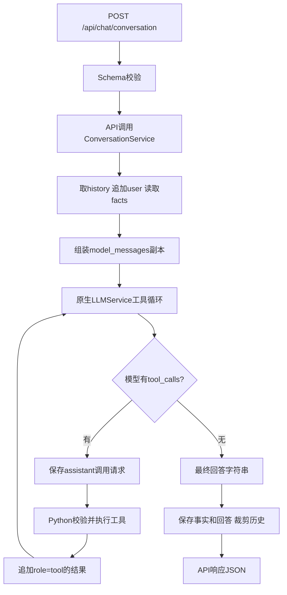
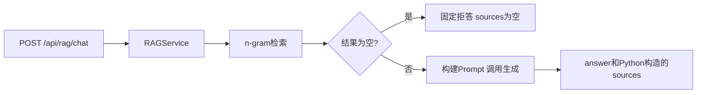

# 三条调用链与数据边界

[返回首页](../README.md) · [代码阅读方法](code-reading.md)

## 正式多轮 Agent

入口：[API](../app/api/chat.py)、[会话服务](../app/services/conversation_service.py)、[模型服务](../app/services/llm_service.py)。

`history` 是按会话保存的列表；`model_messages` 是本次输入副本；`working_messages` 是工具循环中继续追加消息的列表。把 `tool` 消息追加到 working_messages 不会自动写入 history。成功得到回答后才更新当前输入的 facts，保存最终 assistant，裁剪历史。模型异常时回滚当前 user。

同一个用户问题可能经过多次模型请求；SDK 网络重试则是在请求失败后重发。公开版显式关闭自动重试。工具循环最多三次模型请求；到达上限仍无最终正文时返回失败提示。

## 正式独立 RAG

入口：[RAG API](../app/api/rag.py)、[RAGService](../app/services/rag_service.py)。默认文档级 chunk、Top-1、最低分 0.3。三篇短 Markdown 是方便跟踪的示例，不是最佳切分参数建议。

知识工具 [search_knowledge_base](../app/tools/knowledge_tools.py)同样使用 n-gram，但返回 `found/results` 给外层 Agent，不在工具里生成最终答案。独立 RAG 的 `sources` 是结构化字段；Agent 的来源要求主要在答案正文中，两者不能混为一谈。

## 20M：图版学习演示

`patch` 在运行时改变调用目标，“跳转到定义”不会显示这个动态变化。请按下表跟进。

| 步骤 | 位置 | 输入与输出 |
| --- | --- | --- |
| 1 | [20M main](../learning/frameworks/step_20m_knowledge_tool.py) | 创建图、模拟模型，向进程内 HTTP 发商品问题 |
| 2 | [conversation_chat](../app/api/chat.py) | 传 conversation_id/message 给会话服务 |
| 3 | [ConversationService.chat](../app/services/conversation_service.py) | 取历史、组装 model_messages，调用模型服务方法 |
| 4 | [20K make_graph_chat](../learning/frameworks/step_20k_graph_conversation.py) | **第一处替换**：模型服务方法临时转到适配函数；把字典转为消息对象，调用 graph.ainvoke |
| 5 | [20I call_model](../learning/frameworks/step_20i_tool_loop_graph.py) | 读取 State.messages，调用绑定了工具说明的模型 |
| 6 | [20M fake_generate](../learning/frameworks/step_20m_knowledge_tool.py) | **第二处替换**：本次 ChatOpenAI 生成由固定题目映射模拟，返回 search_faq Tool Call |
| 7 | [20I route_after_model / ToolNode](../learning/frameworks/step_20i_tool_loop_graph.py) | 条件边检查有无 tool_calls；ToolNode 按名称调度 |
| 8 | [20M search_faq](../learning/frameworks/step_20m_knowledge_tool.py) → [正式知识工具](../app/tools/knowledge_tools.py) | 真正执行 n-gram 检索，返回 found、snippet、source、chunk_id |
| 9 | ToolNode → model → 20K → 会话服务 → API | ToolMessage 回传，模拟生成正文，适配层取字符串，保存历史并包装响应 |

模型响应被模拟，检索和本地业务真实运行；演示可验证数据传递，但不能证明真实模型会正确选择工具、拒答和引用。20M 只有订单与知识库工具，缺少正式原生版的售后工具。`with patch` 结束后恢复原调用；删除 patch 只会恢复原生实现，不会完成正式迁移。

## 后续工程化方向

当前是学习项目。数据库会话、向量库、部署、生产 Trace、身份与资源归属、真实订单系统均需独立设计和验证。扩展前先说明原有演示边界，不把新增框架依赖当作这些能力已实现。
