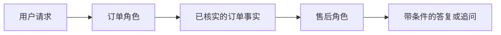

# 多 Agent 23A：角色分工与任务交接

## 学习目标

区分「同一个 Agent 调多个工具」与「多个角色各自完成子任务」，并设计一份最小交接数据。

## 前置知识

理解 [20I 的模型和工具循环](../frameworks/step_20i_tool_loop_graph.md)，会读角色消息和工具结果。

## 文件职责

[23B 订单角色](step_23b_order_agent.py) 定义角色指令和可用工具，[23C 协作图](step_23c_two_agents.py) 把订单事实交给售后。建议先读角色，再读交接状态；本课不要求一次读完整图。

## 具体输入与执行过程

对「查订单10001的物流，再看能否退货」，订单角色先确认订单号与物流；售后角色随后读取规则并检查缺失字段。交接的是 `order_id`、`found`、`status` 等事实。售后不能用「已发货」代替签收时间，也无需复制订单角色整段 Tool Call 历史。



## 运行与预期结果

```console
python -m learning.multi_agent.step_23b_order_agent --task "核实订单10001的物流单号"
```

用框架环境观察两条角色消息和唯一订单工具。本命令只预览，不执行图、工具、数据库或外部模型。

## 常见错误

- 把工具数量当成 Agent 数量：多个角色的区别在于任务、消息与可执行范围。
- 机械地把所有步骤并行：后续角色依赖订单事实，必须先等前置证据。

## 自测与参考答案

把订单工具返回的整段消息历史直接交给售后，会增加什么问题？

<details>
<summary>参考答案</summary>

会增加无关上下文、混入其他角色指令和工具轨迹，且不易检查订单是否一致。只交所需字段、来源与必要的任务标识，更容易限制范围和定位错误。

</details>
